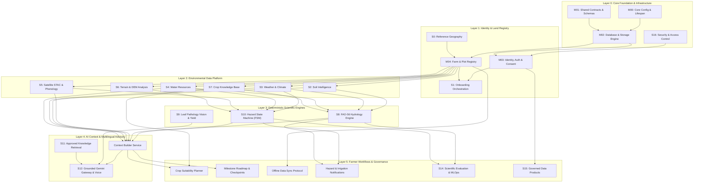
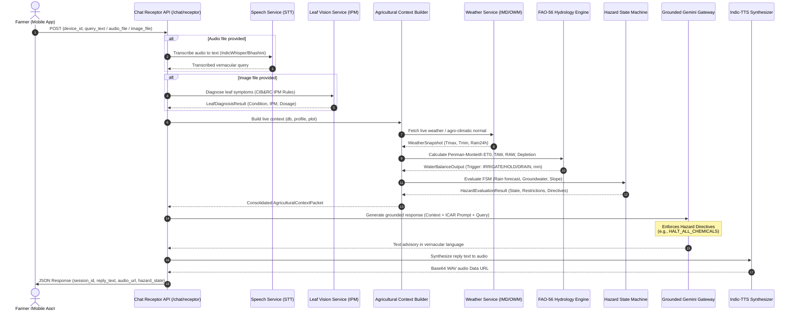

# 🕸️ Krishi Mitra / AgriNova — Module Dependency Graph & Architecture Flow

**Author**: Senior Backend Architect  
**Audit Date**: October 30, 2026  

---

## 1. High-Level Modular Monolith Architecture

The Krishi Mitra backend is structured as a **Modular Monolith**. Modules communicate through explicitly typed Pydantic contracts and internal service interfaces. There are zero circular dependencies; the system forms a strict **Directed Acyclic Graph (DAG)**.

---

## 2. Ingestion & Deterministic Execution Pipeline

A critical architectural mandate is that **deterministic physical calculations occur before AI invocation**. Conversational AI never estimates physical variables.

---

## 3. Comprehensive Module Dependency Matrix

| Module ID | Module Name | Upstream Dependencies | Downstream Consumers | Primary Data Contract |
|---|---|---|---|---|
| **M00** | Core Foundation | Python 3.12, FastAPI, Pydantic | All modules | App lifecycle, settings, DB session |
| **M01** | Shared Contracts | Pydantic v2 | API Routers, Services | Pydantic Request/Response models |
| **M02** | Database Engine | SQLAlchemy 2.0, GeoAlchemy2, PostGIS | Repositories, Services | ORM Models, Session generator |
| **M03** | Identity & Consent | `M00`, `M02`, `S16` | `M04`, `S1`, `S12`, `S15` | `DeviceProfileResponse`, `UserToken` |
| **M04** | Plot Registry | `M02`, `M03`, Shapely | `S1`, `S2`, `S4`, `S6`, Context Builder | `PlotResponse`, `CropCycleResponse` |
| **S0** | Reference Geography | Python stdlib | `M04`, `S3`, `S4` | District medians, Admin codes |
| **S1** | Onboarding Orchestration | `M03`, `M04`, Context Builder | Mobile Client bootstrap | `BootstrapResponse` |
| **S2** | Soil Intelligence | `M02`, `M04` | `S8`, Context Builder, Crop Planner | `SoilHealthResponse`, Benchmarks |
| **S3** | Weather & Climate | `httpx`, OpenWeatherMap, IMD | `S8`, `S10`, Context Builder | `WeatherSnapshot` |
| **S4** | Water Resources | `M02`, `M04` | `S8`, `S10`, Context Builder | `GroundwaterResponse`, CGWB median |
| **S5** | Satellite STAC | `httpx`, Element84 STAC | `S10`, Context Builder | `VegetationIndices` (NDVI, NDWI) |
| **S6** | Terrain & DEM | `M04`, GeoTIFF / DEM | `S10` | Elevation (m), Slope (%) |
| **S7** | Crop Knowledge Base | Python stdlib / DB | `S5`, `S8`, Crop Planner | `FAO56_CROP_PARAMETERS` ($K_c, Z_r, p$) |
| **S8** | FAO-56 Hydrology Engine | `S2`, `S3`, `S4`, `S7` | Context Builder, Notifications | `WaterBalanceOutput` (IRRIGATE/HOLD/DRAIN) |
| **S9** | Leaf Vision & Yield | `httpx`, Gemini Vision, CIB Rules | `S12` | `LeafDiagnosisResult` |
| **S10** | Hazard State Machine | `S3`, `S4`, `S5`, `S6` | Context Builder, Notifications | `HazardEvaluationResult` (Restrictions) |
| **S11** | Knowledge Retrieval (RAG) | PostgreSQL tsvector / pgvector | `S12` | Verified ICAR document citations |
| **S12** | Gemini Chat Gateway | `S8`, `S9`, `S10`, `S11`, Speech | Mobile Client | `ChatReceptorResponse` |
| **S13** | Farmer Workflows | `M04`, `S7`, `S8`, `S10` | Mobile Client | Suitability scores, Milestones, Sync |
| **S14** | Scientific Evaluation | Pytest, Benchmarks | CI/CD | Benchmark validation reports |
| **S15** | Governed Data Products | `M02`, `M03` | External analytics | Anonymized k-anonymous aggregations |
| **S16** | Privacy and Security | Python `hashlib`, PyJWT | All API Routers | JWT tokens, Auth dependencies |

---

## 4. Circular Dependency Audit

An analysis of import paths across `backend/app/` reveals:
- `core/` has **zero** dependencies on `models/`, `api/`, `services/`, or `engines/`.
- `models/` depends only on `core/database.py`.
- `schemas/` depends only on Pydantic and standard library.
- `engines/` depend only on standard library, mathematical formulas, and `services/fallback_data.py`. They have **zero** dependencies on database models, ORM sessions, or external APIs.
- `services/` depend on `models/`, `engines/`, and `core/config.py`.
- `api/` depends on `services/`, `models/`, `schemas/`, and `core/`.

**Verdict**: The dependency structure is strictly acyclic and respects clean layering boundaries.

