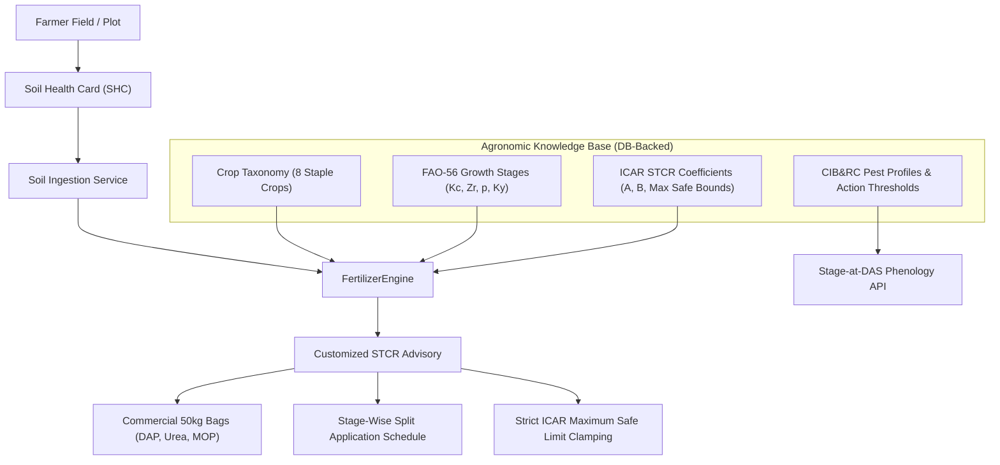

# 🌾 AgriNova / Krishi Mitra — Milestone D Implementation Report
**Crop Knowledge Base & Soil Intelligence Engine**

**Date**: November 2, 2026  
**Branch**: `feature/backend-core`  
**Status**: `COMPLETED & VERIFIED`  
**Test Suite**: **84/84 Tests Passing (100%)**

---

## 1. Executive Summary

**Milestone D** transforms AgriNova from static in-memory fallback dictionaries to a production-grade, database-backed **Agronomic Knowledge Engine** and **Soil Intelligence Subsystem**. It introduces versioned crop taxonomy for 8 staple Indian crops, dynamic FAO-56 phenological growth stage resolution, ICAR Soil Test Crop Response (STCR) targeted yield equations, commercial 50kg fertilizer bag equivalents (Urea, DAP, MOP), and CIB&RC-approved Integrated Pest Management (IPM) guidance.



---

## 2. Core Deliverables & Architectural Implementation

### 2.1 Database Models (`backend/app/models/crop_knowledge.py`)

Five new relational tables were implemented, expanding the database from 17 to **22 physical tables**:

1. **`crops`**: Core agronomic taxonomy storing common name, botanical binomial, season (`KHARIF`, `RABI`, `ZAID`), category (`CEREAL`, `PULSE`, `OILSEED`, `FIBRE`, `CASH`), and standard duration.
2. **`crop_varieties`**: Cultivar and hybrid characteristics including duration, yield potential (q/ha), drought tolerance, and flood tolerance ratings.
3. **`crop_growth_stages`**: Phenological stage bounds by Day After Sowing (DAS), FAO-56 crop coefficients ($K_c$), effective rooting depths ($Z_r$), soil water depletion fractions ($p$), yield response factors ($K_y$), and critical moisture stress flags.
4. **`crop_nutrient_benchmarks`**: ICAR STCR equation parameters ($A_n, B_n, A_p, B_p, A_k, B_k$), default target yields, and maximum safe chemical dosage limits ($N_{\max}, P_{\max}, K_{\max}$).
5. **`crop_pest_profiles`**: Integrated Pest Management (IPM) profiles detailing pest binomials, affected growth stages, symptoms, economic threshold levels (ETL), cultural practices, and CIB&RC approved chemicals and restrictions.

### 2.2 ICAR STCR Fertilizer Engine (`backend/app/engines/fertilizer_engine.py`)

The deterministic fertilizer engine implements the official Indian Council of Agricultural Research (ICAR) Soil Test Crop Response targeted yield equations:

$$\text{Fertilizer Dose (kg/ha)} = A \times \text{TargetYield (q/ha)} - B \times \text{SoilTestValue (kg/ha)}$$

#### Commercial 50kg Bag Conversions:
- **DAP (Di-Ammonium Phosphate)** ($18\% \text{ N}, 46\% \text{ P}_2\text{O}_5$):
  $$\text{DAP (kg/ha)} = \frac{P_{\text{req}}}{0.46}, \quad N_{\text{from DAP}} = \text{DAP} \times 0.18$$
- **Urea** ($46\% \text{ N}$):
  $$\text{Urea (kg/ha)} = \frac{\max(0, N_{\text{req}} - N_{\text{from DAP}})}{0.46}$$
- **MOP (Muriate of Potash)** ($60\% \text{ K}_2\text{O}$):
  $$\text{MOP (kg/ha)} = \frac{K_{\text{req}}}{0.60}$$

#### Safety & Soil Health Constraints:
- **Zero Chemical Overdose Guarantee**: Clamping raw calculation to $[0, \text{MaxSafeDose}]$ strictly prevents chemical toxicity, nitrogen burning, and groundwater nitrate leaching.
- **Split Application Scheduling**:
  - **Basal**: $100\%$ DAP, $1/3$ Urea, $100\%$ MOP.
  - **Vegetative Stage (30 DAS)**: $1/3$ Urea top-dressing.
  - **Flowering / Panicle Initiation**: Remaining $1/3$ Urea top-dressing.
- **Soil Amendment Directives**: Recommends agricultural gypsum for sodic soils ($\text{pH} > 8.5$) and agricultural lime for acidic soils ($\text{pH} < 6.5$).

### 2.3 Seed Service & Baseline Agronomic Catalog (`backend/app/services/crop_seed_service.py`)

Implemented idempotent seed ingestion on startup for 8 staple Indian crops:
- **Cotton** (*Gossypium hirsutum*) — Kharif Fibre
- **Paddy / Rice** (*Oryza sativa*) — Kharif Cereal
- **Wheat** (*Triticum aestivum*) — Rabi Cereal
- **Soybean** (*Glycine max*) — Kharif Oilseed
- **Maize** (*Zea mays*) — Kharif/Rabi Cereal
- **Chickpea / Gram** (*Cicer arietinum*) — Rabi Pulse
- **Mustard** (*Brassica juncea*) — Rabi Oilseed
- **Sugarcane** (*Saccharum officinarum*) — Cash Crop

---

## 3. API Endpoints Inventory

| Method | Endpoint | Handler | Description |
|---|---|---|---|
| `GET` | `/api/v1/crops` | `list_crops` | List crops with season & category filters (`?season=KHARIF&category=FIBRE`) |
| `GET` | `/api/v1/crops/{crop_id}` | `get_crop_detail` | Comprehensive crop dossier with varieties, stages, STCR benchmarks, and pests |
| `GET` | `/api/v1/crops/{crop_id}/stage-at-das` | `get_stage_at_das` | Phenological stage, active $K_c$, rooting depth, and active pest threats at DAS |
| `POST` | `/api/v1/plots/{plot_id}/soil` | `ingest_plot_soil_health` | Ingest Soil Health Card lab results and compute fertility tiers |
| `GET` | `/api/v1/plots/{plot_id}/soil/rating` | `get_plot_soil_rating` | Latest fertility ratings (Low/Med/High), pH classification, and Soil Health Index |
| `POST` | `/api/v1/plots/{plot_id}/fertilizer-recommendation` | `compute_fertilizer_recommendation` | ICAR STCR commercial bag equivalents and stage-wise split schedule |

---

## 4. Verification & Test Suite Results

The test suite expanded from 64 to **84 passing tests** with 0 failures:

```text
======================== 84 passed, 1 warning in 1.19s =========================
```

### New Milestone D Test Modules:
- **`backend/tests/test_crop_knowledge.py`** (8 tests):
  - Idempotent seed execution
  - Crop listing and seasonal/categorical filtering
  - Crop dossier retrieval
  - Stage-at-DAS phenological lookup and active pest threat resolution
  - Out-of-bounds DAS clamping
  - RFC 7807 problem details error responses
- **`backend/tests/test_fertilizer_engine.py`** (6 tests):
  - Low fertility acidic soil amendment directives
  - Balanced neutral fertility scoring
  - High sodic soil gypsum directive
  - Cotton STCR formula evaluation and commercial bag conversions
  - Safe maximum dose clamping
  - High native fertility zero-dose clamping
- **`backend/tests/test_soil_api.py`** (6 tests):
  - Ingestion of Soil Health Card lab values
  - Fallback to regional soil texture benchmarks
  - STCR fertilizer recommendation with explicit target yield
  - Auto-detection of crop name from active crop cycle
  - 404 EntityNotFoundError handling
  - 422 validation error handling for unphysical pH values

---

## 5. Artifacts and Documentation Updated

1. `backend/app/models/crop_knowledge.py` — 5 new SQLAlchemy models
2. `backend/app/engines/fertilizer_engine.py` — Deterministic STCR calculator
3. `backend/app/services/crop_seed_service.py` — Idempotent 8-crop database seeder
4. `backend/app/services/soil_ingestion_service.py` — SHC parser & rating service
5. `backend/app/schemas/crop_knowledge.py` & `fertilizer.py` — Pydantic v2 schemas
6. `backend/app/api/v1/crop_knowledge.py` & `soil.py` — REST API routers
7. `backend/app/main.py` — Lifespan startup seeder & router registration
8. `docs/backend_implementation_status.md` — Modules S2 & S7 marked `IMPLEMENTED`
9. `docs/backend_database_inventory.md` — Physical table inventory updated (Tables 18–22)
10. `docs/backend_api_inventory.md` — 6 new endpoints documented with request/response schemas

