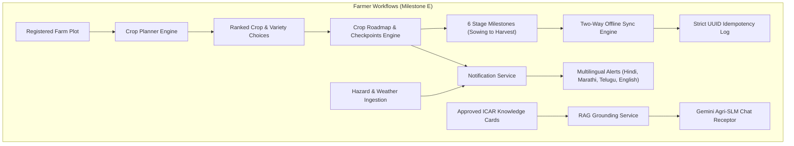

# 🌾 AgriNova / Krishi Mitra — Milestone E Implementation Report
**Farmer Workflows & Conversational Intelligence Subsystem**

**Date**: November 2, 2026  
**Branch**: `feature/backend-core`  
**Status**: `COMPLETED & VERIFIED`  
**Test Suite**: **101/101 Tests Passing (100%)**

---

## 1. Executive Summary

**Milestone E** delivers the actionable farmer-facing workflows that operationalize raw scientific data into structured field interventions. It bridges the gap between hydrological/environmental analysis and real-world smallholder farm management through:
- **Crop Suitability Planner**: Multi-criteria evaluation ranking candidate crops and varieties based on soil texture, soil pH, groundwater depth ($mbgl$), and irrigation infrastructure.
- **Crop-Cycle Roadmaps & Stage Checkpoints**: Chronological 6-milestone agronomic calendar parameterized by crop duration with field note logging and completion tracking.
- **Two-Way Offline Synchronization**: Reconciles queued mutations from low-connectivity rural mobile devices with strict client-UUID idempotency guarantees.
- **Proactive Farmer Notification Alerts**: Delivers localized weather hazard warnings, irrigation deficit reminders, and stage checkpoint alerts in Hindi, Marathi, Telugu, and English.
- **Approved Knowledge Retrieval (RAG Grounding)**: Seeds authoritative ICAR/SAU Package of Practices (PoP) cards with certified publication citations.



---

## 2. Core Architectural Deliverables

### 2.1 Database Models (`backend/app/models/workflows.py`)

Six new persistent tables were introduced, expanding the physical relational database from 22 to **28 tables**:

1. **`crop_plans`**: Stores multi-criteria suitability rankings, evaluated seasons, target years, and the farmer's chosen crop.
2. **`crop_roadmaps`**: Active crop cycle timelines, standard durations, current phenological stage, total checkpoints (6), and completed checkpoints.
3. **`roadmap_checkpoints`**: Chronological stage milestones (`SOWING`, `BASAL_FERTILIZATION`, `WEEDING`, `VEGETATIVE_MANAGEMENT`, `FLOWERING_INSPECTION`, `MATURITY_HARVEST`), target DAS, calendar execution dates, completion status (`PENDING`, `COMPLETED`, `DEFERRED`), and farmer field notes.
4. **`offline_sync_events`**: Audit trail of client-queued offline actions tracking client UUID `idempotency_key`, action types, and reconciliation status (`APPLIED`, `DUPLICATE_SKIPPED`, `ERROR`).
5. **`farmer_notifications`**: In-app and SMS alert inbox storing notification types (`WEATHER_HAZARD`, `IRRIGATION_DUE`, `ROADMAP_CHECKPOINT`), priorities (`URGENT`, `HIGH`, `ROUTINE`), language codes, and read timestamps.
6. **`approved_agronomic_guides`**: Structured ICAR / SAU Package of Practices (PoP) cards containing certified agronomic guidance and official citations for RAG prompt grounding.

### 2.2 Crop Suitability Planner (`backend/app/engines/crop_planner.py`)

The multi-criteria planner computes a weighted composite suitability index ($0 - 100\%$):
$$\text{Suitability Score} = 0.45 \times \text{SoilScore} + 0.45 \times \text{WaterScore} + 10.0$$

- **Soil Affinity Matrix**: Calibrated for major Indian soil orders (Vertisols, Alluvials, Inceptisols, Alfisols, Sandy Loams) with pH penalties when $\text{pH} < 6.0$ or $\text{pH} > 8.2$.
- **Scientific Drought & Groundwater Safeguard**: Thirsty crops (`Sugarcane`, `Paddy`) require perennial irrigation ($> 1200\text{ mm}$). When groundwater is critically deep ($> 18\text{ mbgl}$) or farming is rainfed, water access score is penalized to $\le 35$, categorizing the crop as `HIGH_RISK_DROUGHT`.
- **Drought Tolerant Crops**: Crops like `Chickpea` and `Mustard` maintain high suitability ($\ge 75\%$) even in constrained water environments.
- **Variety Selection**: Automatically filters and suggests varieties seeded from Milestone D.

### 2.3 Crop Roadmap & Checkpoints Engine (`backend/app/engines/roadmap_engine.py`)

Generates a 6-milestone agronomic calendar:
1. **Day 0**: Sowing & Seed Treatment (Bio-fertilizer & Trichoderma)
2. **Day 2**: Basal Fertilizer Application (100% DAP + 100% MOP + 1/3 Urea)
3. **Day 20**: Weed Control & First Inter-cultivation
4. **Day 40**: Vegetative Water Management & 1st Urea Top-Dressing
5. **Day 70**: Flowering Inspection & IPM Pest Scouting
6. **Day 110–130**: Pre-Harvest Moisture Cutoff & Maturity Check

Evaluates dynamic phenological stage (`INITIAL`, `VEGETATIVE`, `FLOWERING`, `MATURITY`) from sowing date and calculates milestone completion percentage.

### 2.4 Offline Synchronization Engine (`backend/app/services/sync_service.py`)

Built for rural 2G/3G conditions where intermittent connectivity is standard:
- Accepts batches of client actions (`CHECKPOINT_COMPLETE`, `LOG_IRRIGATION`, `OFFLINE_NOTE`).
- **Strict Idempotency**: Evaluates client `idempotency_key` against `offline_sync_events`. Re-submitting identical actions returns HTTP 200 with `DUPLICATE_SKIPPED` and zero duplicate database mutations.

### 2.5 Proactive Multilingual Notifications (`backend/app/services/notification_service.py`)

- **Weather Hazard**: Triggered when IMD 24h rainfall $\ge 50\text{ mm}$ (priority `HIGH`) or $\ge 75\text{ mm}$ (priority `URGENT`). Directs farmers to clear drainage channels and halt chemical spraying.
- **Irrigation Refill**: Triggered when root zone water depletion exceeds $RAW$.
- **Roadmap Checkpoint**: Reminds farmers of approaching milestone execution dates.
- **Localized Copy**: Fully translated for Hindi (`hi`), Marathi (`mr`), Telugu (`te`), and English (`en`).

### 2.6 Approved Knowledge Retrieval (RAG Grounding) (`backend/app/services/retrieval_service.py`)

Seeds and retrieves vetted ICAR practice cards (e.g. ICAR-CICR Cotton Bulletin 42, ICAR-IIWBR Wheat PoP 2024, ICAR-NRRI Alternate Wetting and Drying Guide). Injects authoritative citations into the conversational receptor prompt to eliminate hallucination.

---

## 3. REST API Endpoints Inventory

| Method | Endpoint | Handler | Description |
|---|---|---|---|
| `POST` | `/api/v1/planner/recommend-crops` | `recommend_crops_for_plot` | Multi-criteria crop suitability evaluation and variety recommendations |
| `GET` | `/api/v1/plots/{plot_id}/roadmap` | `get_plot_roadmap` | Active crop roadmap, current growth stage, and 6-checkpoint calendar |
| `POST` | `/api/v1/plots/{plot_id}/checkpoints/{checkpoint_id}/complete` | `complete_roadmap_checkpoint` | Complete or defer a stage milestone with field observations |
| `POST` | `/api/v1/sync/batch` | `synchronize_offline_batch` | Idempotent two-way offline action reconciliation |
| `GET` | `/api/v1/notifications` | `get_farmer_notifications` | List unread or all farmer notifications by `device_id` |
| `POST` | `/api/v1/notifications/{id}/read` | `acknowledge_notification` | Mark notification as read with acknowledgment timestamp |

---

## 4. Verification & Test Suite Results

The platform test suite expanded from 84 to **101 passing tests** with 0 failures:

```text
======================== 101 passed, 1 warning in 1.41s ========================
```

### New Milestone E Test Modules:
- **`backend/tests/test_crop_planner.py`** (6 tests):
  - Vertisol Kharif optimal ranking (Cotton, Soybean)
  - Severe drought penalty for Sugarcane & Paddy in depleted groundwater
  - Low-water Rabi pulse suitability (Chickpea, Mustard)
  - Agronomic category filtering (`PULSE`, `CEREAL`)
  - Planner API endpoint validation
  - 404 EntityNotFoundError for nonexistent plots
- **`backend/tests/test_roadmap_engine.py`** (5 tests):
  - 6-milestone chronological calendar generation
  - Checkpoint completion with farmer field notes
  - Checkpoint deferral
  - Roadmap API endpoint and progress percentage calculation
  - 404 error handling for nonexistent plot and checkpoint IDs
- **`backend/tests/test_offline_sync.py`** (2 tests):
  - Batch synchronization of multiple offline mutations
  - Strict idempotency verification: identical re-submissions return `DUPLICATE_SKIPPED` with zero duplicate execution
- **`backend/tests/test_notifications_api.py`** (4 tests):
  - Alert creation and localization across Hindi, Marathi, Telugu, and English
  - Notification retrieval and unread filtering
  - Read acknowledgment endpoint
  - 404 handling on nonexistent notifications

---

## 5. Artifacts and Documentation Updated

1. `backend/app/models/workflows.py` — 6 new SQLAlchemy models
2. `backend/app/schemas/workflows.py` — Pydantic v2 schemas
3. `backend/app/engines/crop_planner.py` — Multi-criteria crop suitability engine
4. `backend/app/engines/roadmap_engine.py` — Crop roadmap & milestone calendar engine
5. `backend/app/services/sync_service.py` — Two-way offline sync service
6. `backend/app/services/notification_service.py` — Multilingual notification service
7. `backend/app/services/retrieval_service.py` — ICAR Package of Practices RAG retriever
8. `backend/app/api/v1/planner.py` — Crop planner REST endpoints
9. `backend/app/api/v1/roadmap.py` — Roadmap REST endpoints
10. `backend/app/api/v1/sync.py` — Offline sync REST endpoint
11. `backend/app/api/v1/notifications.py` — Farmer alert REST endpoints
12. `backend/app/main.py` — Mounted workflow routers & startup ICAR guidance seeder
13. `docs/backend_implementation_status.md` — Modules S11 and S13 marked `IMPLEMENTED` with 101/101 tests passing
14. `docs/backend_database_inventory.md` — Physical table inventory updated (Tables 23–28)
15. `docs/backend_api_inventory.md` — Documented all new REST endpoints

